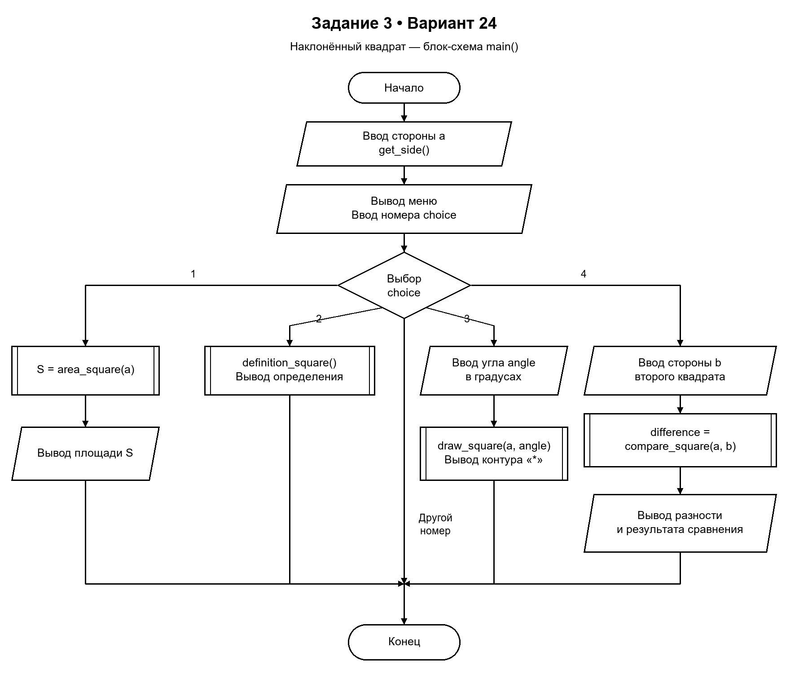

# Лабораторная работа №10

## Задание 3. Вариант 24 — наклонённый квадрат

Программа на языке C работает с наклонённым квадратом. Параметры фигуры — длина стороны и угол наклона. При рисовании выводится только контур символами `*`.

## Условие задания

Предусмотреть меню выбора операции:

1. Рассчитать площадь фигуры.
2. Вывести определение фигуры.
3. Нарисовать фигуру.

Операции оформить отдельными функциями. Также реализовать ввод параметров фигуры и функцию сравнения площадей двух фигур.

## Реализованное меню

В последней версии программы используются четыре пункта:

| Пункт | Операция |
| --- | --- |
| 1 | Вычисление площади квадрата |
| 2 | Вывод определения квадрата |
| 3 | Рисование контура с заданным наклоном |
| 4 | Сравнение площадей двух квадратов |

Четвёртый пункт предоставляет доступ к функции сравнения, указанной отдельно в условии. Программа выполняет одну выбранную операцию и завершается.

## Параметры и вычисления

- `a` — положительная длина стороны первого квадрата.
- `angle` — угол наклона в градусах, вводится при выборе рисования.
- `b` — положительная длина стороны второго квадрата, вводится при сравнении.

Площадь квадрата: **S = a²**. Наклон не изменяет площадь.

При сравнении вычисляется **ΔS = a² − b²**. Положительная разность означает, что первый квадрат больше по площади; отрицательная — что больше второй; нулевая — что площади равны.

Квадрат — четырёхугольник с равными сторонами и прямыми углами.

## Функции программы

| Функция | Назначение |
| --- | --- |
| `double get_side(void)` | Ввод стороны квадрата |
| `double area_square(double a)` | Возвращает площадь квадрата |
| `void definition_square(void)` | Выводит определение фигуры |
| `void draw_square(double a, double angle)` | Рисует контур наклонённого квадрата |
| `double compare_square(double a, double b)` | Возвращает разность площадей |
| `int main(void)` | Организует ввод, выбор операции и вывод результата |

## Рисование контура

Угол переводится из градусов в радианы. Для каждой позиции консоли вычисляются координаты в системе квадрата с помощью обратного поворота. Если позиция находится около одной из четырёх сторон, выводится `*`, иначе — пробел. Внутренняя область не заполняется.

По горизонтали используется шаг 0,5, по вертикали — 1, чтобы учитывать вытянутую форму символов консоли. Изображение контура приближённое.

## Блок-схема основной программы

Блоки вызова функций показывают операции целиком. При сравнении функция возвращает разность площадей, после чего программа выводит разность и сообщает результат сравнения. Если введён номер вне меню, ни одна операция не выполняется и программа завершается.